# Frame-accurate storyboard

## 01 Fragmented work

Frames0–179: Three articulated colleagues use separate desks; disconnected cobalt strokes; headline changes at frame 81.

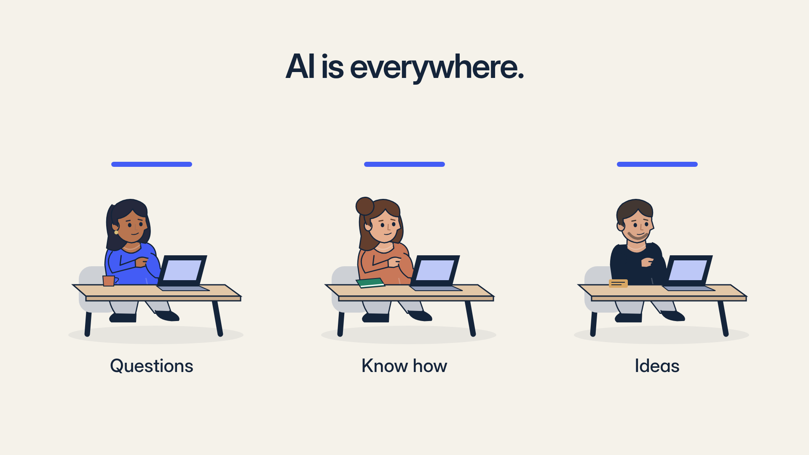

## 02 Welcome

Frames180–299: Strokes resolve into the authentic app mark; company purpose; cobalt field.

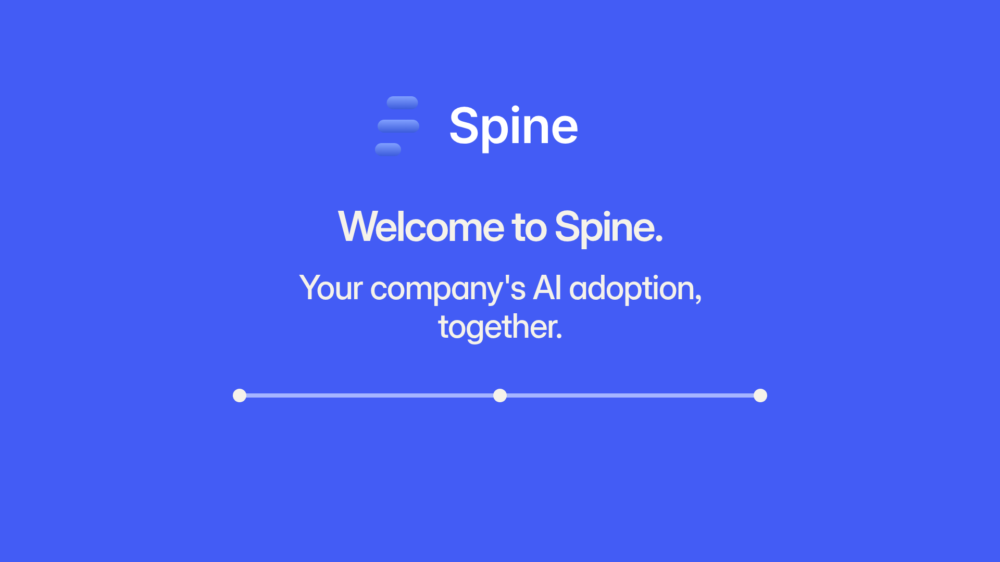

## 03 Company-specific help

Frames300–659: Question holds 15–134; actual Claim 135–161; completed answer and labelled summary from 165.

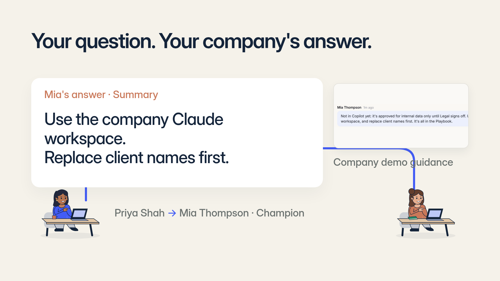

## 04 Shared knowledge

Frames660–839: Editorial privacy bridge; Ben receives the real Already answered suggestion. No invented sharing action.

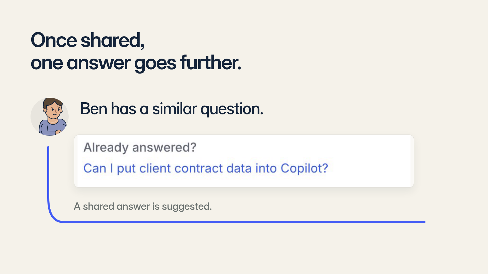

## 05 Idea approval

Frames840–1049: One Supplier Research Assistant idea, problem summary; recorded human Approve 135–153; forming-team evidence from 154.

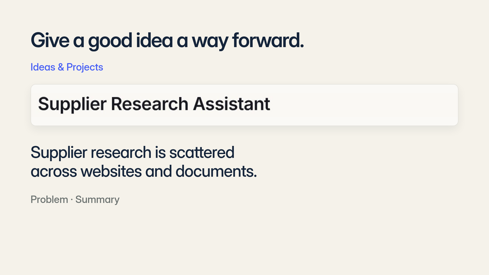

## 06 Voluntary collaboration

Frames1050–1319: One of three; real Join 30–55; two of three from 56; two articulated people bring desks to a common table during 60–95; third seat open.

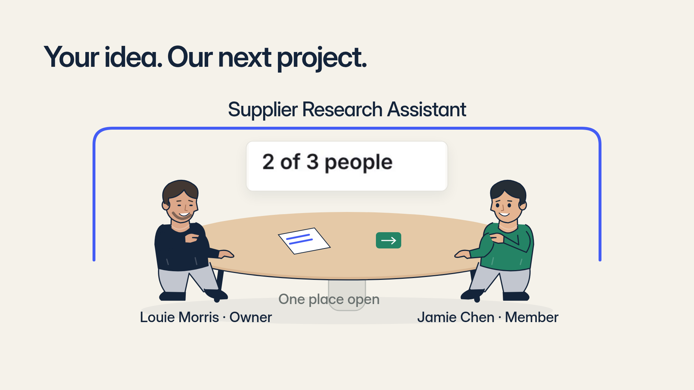

## 07 Owned plan

Frames1320–1529: Recorded first-step completion 15–44; updated Jamie next action from 45. AI drafts, people own work.

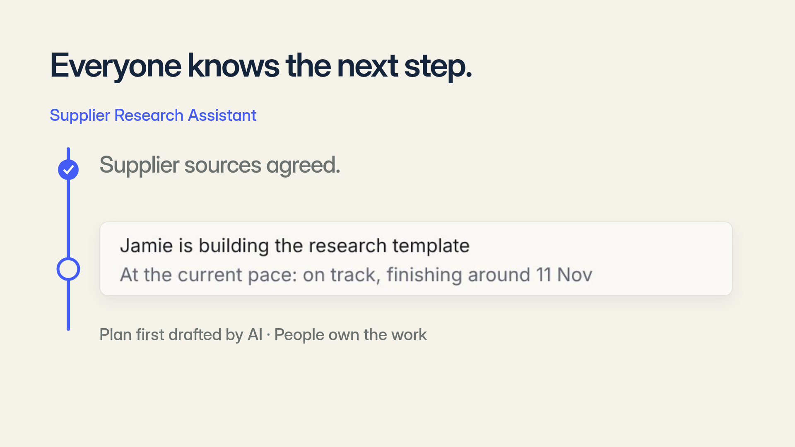

## 08 Blocker, Pulse, recovery

Frames1530–1829: Blocked check-in summary 0–89; actual Pulse item90–154; Open155–179; human recovery submission180–194; posted On track check-in195–299.

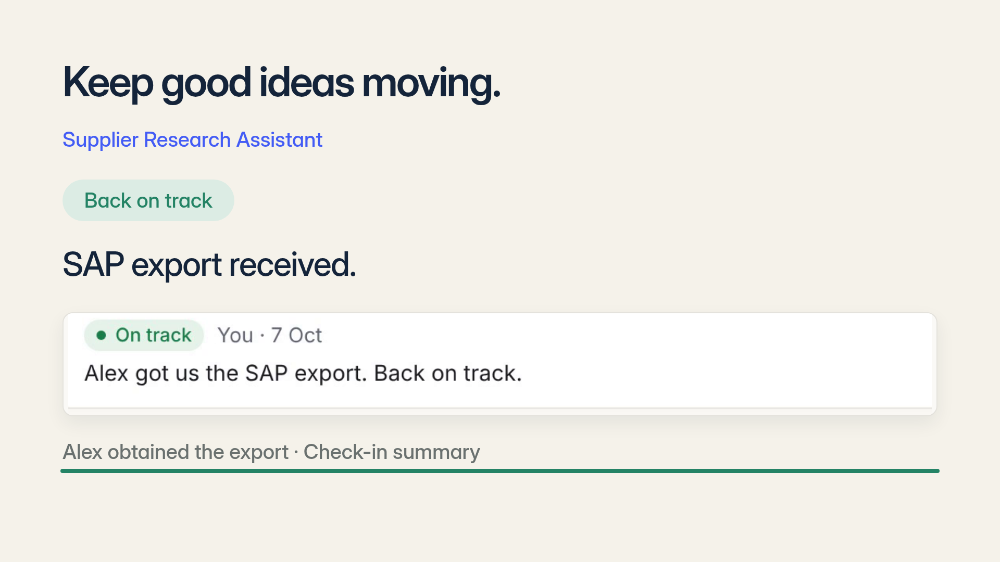

## 09 Live

Frames1830–1979: Actual Mark Live8–29; actual green Live state30–149. No invented research-tool output.

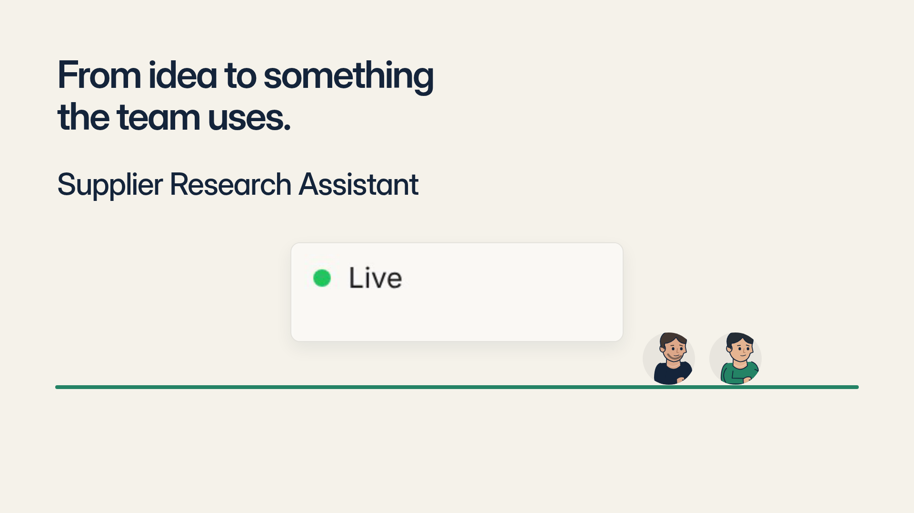

## 10 Reported and verified

Frames1980–2249: Reported equation0–89; actual Verify90–104; verified12hours105–194; Leadership Went live195–269. Persistent demo disclosure, Alex outside project.

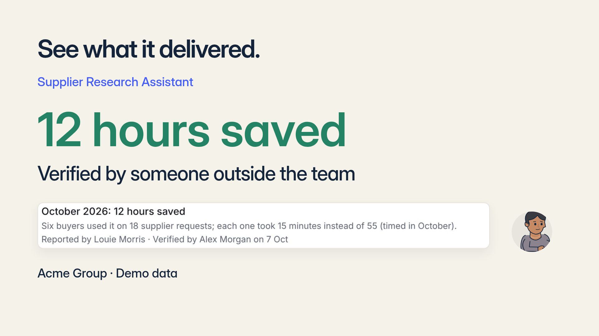

## 11 Invitation

Frames2250–2399: Genuine vector brand; stable hero, descriptor and Book a demo. No invented URL.

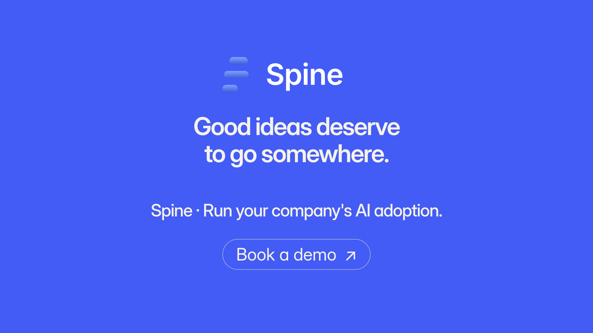